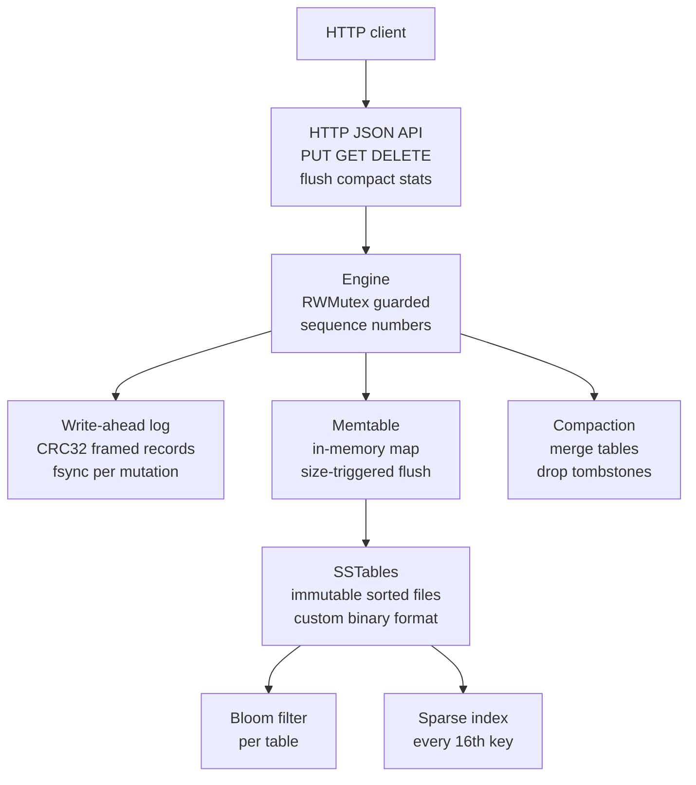

# Stonebridge — LSM-Tree Storage Engine in Go

[](https://go.dev)
[](LICENSE)
[](#validation)
[](#benchmarks)

## Overview

<p align="justify">
<b>Stonebridge</b> is a single-node LSM-tree (Log-Structured Merge-tree) key-value storage engine written from scratch in Go, with no storage dependencies. It implements the complete write and read path of a modern embedded storage engine: a CRC32-checksummed write-ahead log for crash durability, an in-memory memtable with size-triggered flushing, immutable sorted-string tables (SSTables) in a custom length-prefixed binary format, per-table Bloom filters and sparse key indexes for efficient point lookups, tombstone-based deletion, WAL replay with sequence-number reconciliation on startup, and manual compaction that merges tables while dropping shadowed versions and tombstones. The engine is exposed through a small HTTP JSON API with graceful shutdown semantics and ships with containerized deployment. It is designed as a graduate-level systems portfolio project demonstrating that the storage layer beneath databases like RocksDB, LevelDB, and Cassandra can be understood deeply enough to be rebuilt.
</p>

> **Status and guarantees:** this is a portfolio and learning implementation, not a production database. The WAL is fsynced on every mutation by default, but absolute durability still depends on the operating system and storage device. Review `docs/DESIGN.md` before trusting it with important data. Do not expose the HTTP API to untrusted networks without authentication and TLS.

## Demonstration

<p align="justify">
The following transcript was captured from a live instance of the service, showing the full key lifecycle: insert, read, delete, and the correct 404 after deletion.
</p>

```bash
$ go run ./cmd/stonebridge -dir ./stonebridge-data -http 127.0.0.1:8080

$ curl -s http://127.0.0.1:8080/healthz
{"status":"ok"}

$ curl -s -X PUT http://127.0.0.1:8080/v1/kv/user:1 \
    -H 'Content-Type: application/json' -d '{"value":"ada"}' -o /dev/null -w "%{http_code}\n"
204

$ curl -s http://127.0.0.1:8080/v1/kv/user:1
{"key":"user:1","value":"ada"}

$ curl -s -X DELETE http://127.0.0.1:8080/v1/kv/user:1 -o /dev/null -w "%{http_code}\n"
204

$ curl -s -o /dev/null -w "%{http_code}\n" http://127.0.0.1:8080/v1/kv/user:1
404

$ curl -s http://127.0.0.1:8080/v1/stats
{"memtable_entries":0,"memtable_bytes":0,"sstables":0,"keys_approx":0,"wal_bytes":0,"next_sequence":1}
```

## System Architecture



## Methodology

<p align="justify">
<b>Write path.</b> Every mutation is first appended to the write-ahead log as a length-prefixed, CRC32-checksummed JSON record, then fsynced (configurable via <code>SyncWrites</code>), and only then applied to the in-memory memtable with a monotonically increasing sequence number. When the memtable reaches its configured byte threshold, it is sorted by key and flushed to an immutable SSTable written through a temporary file and atomic rename, after which the WAL is safely truncated. This ordering — WAL first, memtable second, table third — is the invariant that makes crash recovery correct: any mutation visible to readers is either in the WAL or in a flushed table, never in neither.
</p>

<p align="justify">
<b>SSTable format.</b> Each table file begins with an 8-byte magic header (<code>STONE001</code>) and a record count, followed by records encoded as a 17-byte header (4-byte key length, 4-byte value length, 1-byte tombstone flag, 8-byte sequence number) plus the raw key and value bytes. On load, the magic, record counts, and length bounds are validated before any record is trusted, so a torn or corrupt file fails loudly at open time rather than serving silent corruption.
</p>

<p align="justify">
<b>Read path.</b> Reads check the memtable first, then consult SSTables from newest to oldest. Each table carries a Bloom filter (10 bits per key, 7 hash functions via double hashing over FNV-1a) that lets the engine skip tables that cannot contain the key, and a sparse index sampling every 16th key that narrows the binary search to a 16-record window. The first table containing the key wins; a tombstone at that position correctly masks all older versions and returns not-found. This newest-wins ordering is what makes overwrites and deletes behave correctly across flushes.
</p>

<p align="justify">
<b>Crash recovery.</b> On startup, the engine loads all SSTables (newest first), restores the next table id and sequence number from the maximum observed values, then replays the WAL from the beginning. Replay stops safely at the first malformed, truncated, or checksum-mismatched record — the expected shape of a torn tail after a crash. Each replayed record is checked against the loaded tables by sequence number so that already-flushed mutations are not double-applied. This recovery path is covered by a dedicated test that writes, flushes, writes more, reopens <i>without closing</i> (simulating a crash), and verifies every key.
</p>

<p align="justify">
<b>Compaction.</b> Manual compaction flushes any pending memtable data, then merges all tables oldest-to-newest into a single table, keeping only the newest version of each key and dropping tombstones (safe because no older tables survive the merge). Obsolete table files are deleted from disk. The result is a single sorted table with no dead versions — the same principle behind leveled compaction in production LSM engines, implemented here as a full merge for clarity.
</p>

## API Reference

| Method | Endpoint | Description |
|---|---|---|
| `PUT` | `/v1/kv/{key}` | Insert or overwrite; JSON body `{"value":"..."}` → `204` |
| `GET` | `/v1/kv/{key}` | Read; → `{"key":"...","value":"..."}` or `404` |
| `DELETE` | `/v1/kv/{key}` | Tombstone-delete → `204` |
| `POST` | `/v1/flush` | Flush the memtable to a new SSTable → `204` |
| `POST` | `/v1/compact` | Merge all tables, drop tombstones → `204` |
| `GET` | `/v1/stats` | Engine statistics: memtable usage, table count, sequence state |
| `GET` | `/healthz` | Liveness probe |

<p align="justify">
Keys are URL path segments (percent-decoding applied); values in the HTTP API are UTF-8 strings, while the storage engine itself operates on arbitrary byte slices. Request bodies are capped at 8 MiB with unknown JSON fields rejected.
</p>

## Benchmarks

<p align="justify">
Measured with the bundled benchmark (<code>go run ./cmd/bench</code>): 50,000 puts of 100-byte values followed by 50,000 point reads and 10,000 missing-key lookups, on this machine with WAL fsync disabled for the write measurement. These numbers characterize this implementation at modest scale with default tuning; they are reproducible, not a claim about production databases.
</p>

| Operation | Throughput |
|---|---:|
| Writes (100-byte values) | **53,547 writes/s** |
| Point reads (hits) | **1,599,018 reads/s** |
| Missing-key lookups (Bloom path) | **1,497,191 lookups/s** |

<p align="justify">
Reads are fast because the hot path is a map lookup or a Bloom-filter rejection plus a narrow binary search. Writes are dominated by JSON WAL encoding — a deliberate clarity trade-off; a binary WAL record format would raise write throughput substantially and is documented as future work.
</p>

## Project Structure

```text
stonebridge/
├── cmd/
│   ├── stonebridge/      # HTTP service: flags, graceful shutdown
│   └── bench/            # Throughput benchmark utility
├── internal/lsm/
│   ├── engine.go         # WAL, memtable, flush, compaction, recovery
│   ├── table.go          # SSTable binary format, Bloom filter, sparse index
│   ├── bloom.go          # Bloom filter (FNV-1a double hashing)
│   ├── http.go           # HTTP JSON API
│   └── *_test.go         # Unit, recovery, and API tests
├── docs/DESIGN.md        # Design notes and trade-offs
├── Dockerfile
├── docker-compose.yml
└── go.mod
```

## Validation

```bash
go vet ./...
go test ./... -count=1
go test -race ./internal/lsm/ -count=1
go run ./cmd/bench
```

<p align="justify">
The test suite covers put/get/delete semantics, flush and restart behavior, tombstone masking across tables, WAL recovery including torn-tail truncation, compaction correctness (overwrites win, deletes disappear, single table remains), the crash-recovery scenario described above, and the full HTTP API contract. The race detector runs clean.
</p>

## Storage Layout

<p align="justify">
Each database directory contains <code>stonebridge.wal</code> (the append-only checksummed mutation log) and <code>table-&lt;20-digit-id&gt;.sst</code> files (the immutable sorted tables). No lock file is implemented; only one process may open a directory at a time.
</p>

## Deliberate Scope Boundaries

<p align="justify">
This engine is explicit about what it omits. There is no write-ahead-log segmentation or archival — the WAL is truncated on flush, so point-in-time recovery is not supported. Compaction is manual and merges all tables at once rather than implementing leveled or tiered strategies with size-tiered file selection. There is no compression (Snappy/LZ4), no block cache, no range-scan iterator API, and no multi-version concurrency control — reads see the latest committed state under a read-write mutex. The HTTP API has no authentication. These are documented as future work rather than implied capabilities, and each is a well-understood extension of the correct core this repository provides.
</p>

## Roadmap

<p align="justify">
The natural extensions, in order of leverage, are: a binary WAL record format replacing JSON to lift write throughput; range-scan iterators with merge-join across the memtable and tables; leveled compaction with size-tiered file selection instead of full merges; block compression and a block cache for the SSTable read path; WAL segmentation with point-in-time recovery; and multi-process safety via lock files. Each extension is measurable against the current implementation with the bundled benchmark, so progress is never a matter of assertion.
</p>

## Resume Bullet

<p align="justify">
Built Stonebridge, an LSM-tree key-value storage engine in Go implementing a checksummed write-ahead log, memtable with size-triggered flush, immutable SSTables with Bloom filters and sparse indexes, tombstone deletion, crash recovery via WAL replay, and compaction; measured 53k writes/s and 1.6M reads/s on the bundled benchmark.
</p>

## License

<p align="justify">
Distributed under the MIT License. See <code>LICENSE</code> for the full text.
</p>
